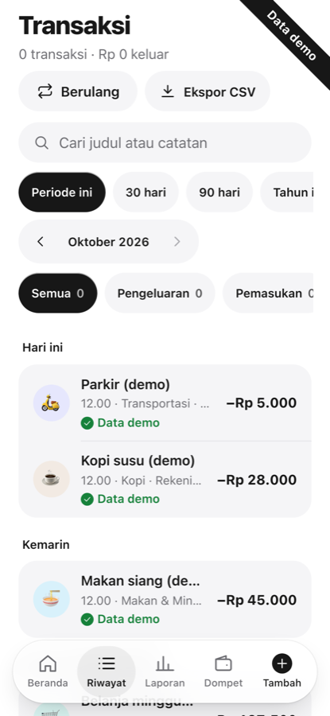
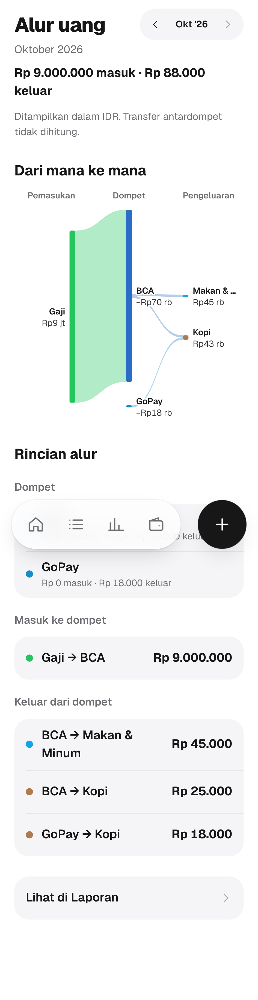
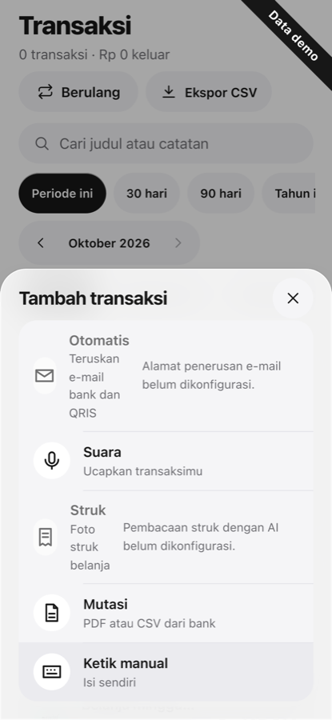
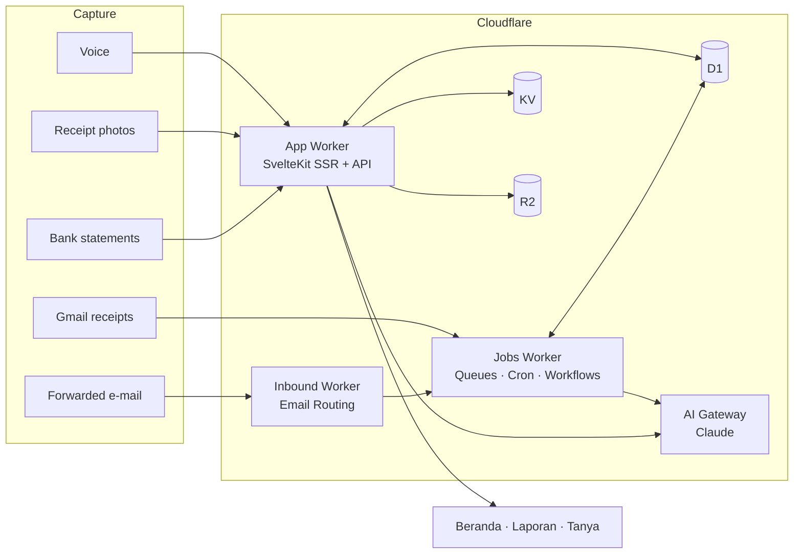

<div align="center">

# Montra

**The money tracker that fills itself.**

Receipts, voice notes, bank statements and Gmail receipts become one clear monthly number,<br>
budgets you can actually keep, your net worth, and an assistant that answers from your own records.

[](https://github.com/studiomicro/montra/actions/workflows/ci.yml)
[](https://github.com/studiomicro/montra/actions/workflows/codeql.yml)
[](LICENSE)


<br>


&nbsp;&nbsp;

&nbsp;&nbsp;


<sub>Screenshots use fictional demo data.</sub>

</div>

---

## Why Montra

Most money apps die the same way: you stop typing in every coffee. Montra is built so you barely have to.

|                                         |                                                                                                                                                                                                                                                       |
| --------------------------------------- | ----------------------------------------------------------------------------------------------------------------------------------------------------------------------------------------------------------------------------------------------------- |
| 🧾 **It fills itself**                  | Payments arrive from Gmail receipts (read-only), forwarded e-mail, voice ("kopi 25 ribu pakai GoPay"), receipt photos, screenshots and bank statement imports.                                                                                        |
| 🏦 **Reads real Indonesian statements** | BCA, BNI, Mandiri and OCBC PDFs, CSV and spreadsheets, checked month by month so a missing statement shows up as a gap, never as made-up money.                                                                                                       |
| 🔁 **Knows a transfer is not spending** | Matches your own transfers between wallets (BCA → OCBC) so they stop counting as both money out and money in.                                                                                                                                         |
| 🎯 **One number first**                 | Beranda opens on this month's spending, a safe-to-spend figure and your budgets, in rupiah, not percentages.                                                                                                                                          |
| 💬 **Ask your own records**             | "How much did I spend on food in September?" Answers come only from your stored rows, with the rows to prove it.                                                                                                                                      |
| 👨‍👩‍👧 **Shared spaces**                    | A personal space plus shared spaces for up to five people, with owner and member roles. Split bills with Patungan.                                                                                                                                    |
| 📈 **The whole picture**                | Net worth, subscriptions, recurring payments, money-flow charts, streaks and reports.                                                                                                                                                                 |
| 🌏 **Speaks your language**             | Bahasa Indonesia and English today; Spanish, Arabic (right-to-left), French, German, Portuguese, Malay, Vietnamese, Chinese, Japanese, Korean, Thai and Hindi are on the way. Money stays exact in every language: switching never changes an amount. |
| 📱 **An app without the app store**     | Installable PWA with push notifications, offline queue, light and dark themes, phone-first from 360 px up to desktop.                                                                                                                                 |
| 🔐 **Private by design**                | Passkeys, a bot check on sign-in, and imported results sealed to your account key (X25519 + AES-256-GCM). Uploads are read in memory and never stored.                                                                                                |

## What Montra is not

- **Not a bank or a wallet.** It holds no funds and moves no money.
- **Never asks for a bank login, PIN, password or OTP.**
- **No ads, no third-party trackers, no data sale.** Mailbox data is never used for ads, credit scoring or lending.
- **Not advice.** Reports and assistant answers are information, not financial, investment, tax or legal advice.
- **AI reads are drafts.** A model can misread a receipt, so you check before it is saved.

## How it works



- **Money is never invented.** Amounts are integer minor units with an ISO 4217 currency; balances and totals are always computed from stored rows.
- **Dates are local.** Every day and month bucket uses the WIB calendar date, not UTC.
- **Every row belongs to one space**, and every server query goes through one space-access helper.
- **Captures are idempotent.** Each source carries a dedupe key, so a row you deleted is never recreated from the same e-mail or statement.

## Tech stack

**Frontend** Svelte 5 · SvelteKit · TypeScript · Tailwind CSS v4 · hand-made SVG charts · Geist<br>
**Platform** Cloudflare Workers · D1 + Drizzle · R2 · KV · Queues · Workflows · Email Routing · AI Gateway · Analytics Engine<br>
**Quality** Vitest (unit and integration on a local D1) · Playwright (phone, iPhone and desktop projects) · GitHub Actions · CodeQL

## Quick start

Requires Node 22 or newer.

```sh
git clone https://github.com/studiomicro/montra.git
cd montra
npm ci
cp .dev.vars.example .dev.vars   # local variables; fill only what you need
npm run db:migrate:local         # apply migrations to the local D1
npm run db:seed:local            # fictional demo data, badged "Data demo"
npm run dev                      # http://localhost:5173
```

| Script                | What it does                                                |
| --------------------- | ----------------------------------------------------------- |
| `npm test`            | Vitest: domain, parsers and integration tests on a local D1 |
| `npm run test:e2e`    | Playwright journeys on phone, iPhone and desktop            |
| `npm run gates`       | check, lint, test and build: what CI runs                   |
| `npm run dev:workers` | the jobs and inbound Workers, locally                       |

Features that need a provider (Gmail, the assistant, push, Turnstile) stay off and say "Belum dikonfigurasi" until you add their keys. Nothing fails silently.

## Languages

Bahasa Indonesia is the default and English is complete. More languages are being added: Spanish first, then Arabic (right-to-left), French, German, Portuguese, Malay, Vietnamese, Chinese, Japanese, Korean, Thai and Hindi. Native speakers are very welcome to review them: see [CONTRIBUTING.md](CONTRIBUTING.md).

## Self-hosting

Montra runs entirely on Cloudflare. [docs/SELF_HOSTING.md](docs/SELF_HOSTING.md) lists the resources and secrets you need and which ones are optional; [docs/RUNBOOK.md](docs/RUNBOOK.md) covers deploys and CI/CD.

## Contributing

Bug reports, statement samples from banks we do not read yet (with your numbers removed), translations and code are all welcome. Start with [CONTRIBUTING.md](CONTRIBUTING.md) and the [Code of Conduct](CODE_OF_CONDUCT.md).

Found a vulnerability? Please report it privately as described in [SECURITY.md](SECURITY.md), not in a public issue.

## License

Montra is free software under the [GNU Affero General Public License v3.0](LICENSE) (`AGPL-3.0-only`). If you run a modified version as a network service, you must offer its source code to its users. The app shows that link under Pengaturan › Tentang when `SOURCE_URL` is set.

Bank, e-wallet and merchant names shown in the app belong to their owners and are used only to identify them. Bundled fonts (Geist, SIL OFL 1.1) keep their own licence files.

<div align="center">
<sub>Made in Indonesia by <a href="https://github.com/studiomicro">studiomicro</a>.</sub>
</div>
